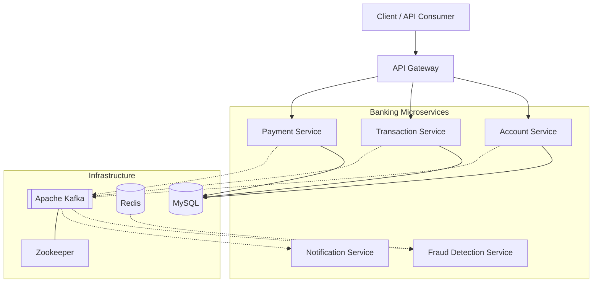

# 🏦 Digital Banking System

<p align="center">
  
</p>

<p align="center">
  A microservices-based banking backend built to explore account management, distributed services, and event-driven architecture.
</p>

<p align="center">
  
  
  
  
  
  
  
</p>

<p align="center">
  <a href="https://github.com/ethyne2666/digital-banking-system">Repository</a> •
  <a href="https://github.com/ethyne2666/digital-banking-system/issues">Issues</a> •
  <a href="https://github.com/ethyne2666/digital-banking-system/commits/main/">Commits</a>
</p>

---

## ✨ About the Project

Digital Banking System is a backend project built using **Spring Boot microservices** and supporting infrastructure for distributed banking applications.

The project separates banking responsibilities into individual services and uses technologies such as MySQL, Redis, and Apache Kafka to explore data persistence, inter-service communication, and event-driven design.

### 🎯 What I'm Building

* 🏦 Account creation and balance management
* 🔄 Separate transaction and payment services
* 🛡️ A dedicated fraud detection service
* 📩 A notification service
* 🌐 An API Gateway
* 🐳 Containerized infrastructure with Docker Compose

---

## 🏗️ Architecture



<sub>Architecture overview: the diagram illustrates the intended service relationships. Actual routes, event flows, and integrations depend on each service's implementation.</sub>

---

## 🧩 Microservices

| Service                       | Responsibility                                                            |
| ----------------------------- | ------------------------------------------------------------------------- |
| 🏦 `account-service`          | Account creation, account details, balance operations, and account status |
| 🔄 `transaction-service`      | Transaction-related business logic                                        |
| 💳 `payment-service`          | Payment processing responsibilities                                       |
| 🛡️ `fraud-detection-service` | Fraud analysis responsibilities                                           |
| 📩 `notification-service`     | Notification processing and delivery responsibilities                     |
| 🌐 `api-gateway`              | Entry point for routing client requests                                   |

Each service is maintained in its own directory, helping separate business logic and supporting independent development.

---

## ⚙️ Tech Stack

<p>
  
</p>

| Technology      | Used for                                |
| --------------- | --------------------------------------- |
| Java 17         | Backend development                     |
| Spring Boot     | Microservice applications               |
| Spring Data JPA | Database access                         |
| Hibernate       | Object-relational mapping               |
| Maven           | Dependencies and builds                 |
| MySQL 8.0       | Relational data storage                 |
| Redis           | In-memory data operations               |
| Apache Kafka    | Event streaming                         |
| Zookeeper       | Kafka coordination in the current setup |
| Docker Compose  | Local infrastructure                    |

---

## 📂 Project Structure

```text
digital-banking-system/
│
├── account-service/
├── api-gateway/
├── transaction-service/
├── payment-service/
├── fraud-detection-service/
│
├── notification-service/
├── docker-compose.yml
├── .gitignore
└── README.md
```

---

## 🚀 Getting Started

### Prerequisites

Make sure you have these installed:

* [Java 17](https://adoptium.net/)
* [Maven](https://maven.apache.org/)
* [Docker Desktop](https://www.docker.com/products/docker-desktop/)
* [Git](https://git-scm.com/)

Check your installation:

```bash
java -version
mvn -version
docker --version
docker compose version
```

### 1. Clone the repository

```bash
git clone https://github.com/ethyne2666/digital-banking-system.git

cd digital-banking-system
```

### 2. Start the infrastructure

```bash
docker compose up -d
```

This starts the infrastructure defined in `docker-compose.yml`, including MySQL, Redis, Kafka, and Zookeeper.

Check the containers:

```bash
docker compose ps
```

View logs:

```bash
docker compose logs -f
```

### 3. Run a microservice

Open a separate terminal for each service you want to run.

For example, to start the Account Service:

```bash
cd account-service
mvn spring-boot:run
```

To build it without starting the application:

```bash
mvn clean package
```

Repeat the process for other services after checking their configuration and infrastructure requirements.

> **Note:** Starting the Compose infrastructure does not automatically start the Spring Boot services. The commands above run the application separately on your development machine.

---

## 🐳 Docker Commands

| Command                  | Purpose                                        |
| ------------------------ | ---------------------------------------------- |
| `docker compose up -d`   | Start infrastructure                           |
| `docker compose ps`      | Check container status                         |
| `docker compose logs -f` | Follow logs                                    |
| `docker compose stop`    | Stop containers without removing them          |
| `docker compose start`   | Start stopped containers                       |
| `docker compose down`    | Stop and remove Compose containers and network |
| `docker compose down -v` | Also remove Compose-managed named volumes      |

**Warning:** `docker compose down -v` can delete persisted database data stored in Compose-managed volumes.

---

## 🧪 API Testing

Use [Postman](https://www.postman.com/) or `curl` to test the HTTP endpoints exposed by the services.

For the Account Service, start by exploring:

* Create an account
* Retrieve account details
* Retrieve an account balance
* Credit or debit an account
* Block an account

The exact HTTP methods, endpoint paths, request bodies, and response formats should be taken from the current controller classes.

---

## 🔐 Configuration & Security

Before running the project outside your local development environment:

* Store database credentials in environment variables or a secrets manager.
* Never commit real credentials, API keys, or tokens.
* Configure authentication and authorization for sensitive banking operations.
* Validate account ownership before allowing balance access or modification.
* Protect Kafka and Redis from unauthorized access.
* Use HTTPS for externally accessible APIs.
* Add database constraints and concurrency safeguards for financial operations.

---

## 🛣️ Roadmap

* [ ] Complete and validate all service integrations
* [ ] Implement transaction workflows across services
* [ ] Integrate Kafka producers and consumers where required
* [ ] Strengthen account and transaction consistency
* [ ] Add authentication and authorization
* [ ] Add automated unit and integration tests
* [ ] Add health checks and centralized logging
* [ ] Create Docker images for application services
* [ ] Set up CI/CD with GitHub Actions
* [ ] Explore cloud deployment and monitoring

---

## 🤝 Contributing

Suggestions, bug reports, and improvements are welcome.

1. Fork the repository.
2. Create a feature branch.
3. Make your changes.
4. Test your changes.
5. Open a pull request with a clear description.

---

## 👨‍💻 Author

**Charan Kumar**

<p>
  <a href="https://github.com/ethyne2666">
    
  </a>
  <a href="https://www.linkedin.com/in/charan-kumar-ab5568311/">
    
  </a>
  <a href="https://charankumar.com">
    
  </a>
</p>

---

<p align="center">
  <b>Built with Java, Spring Boot, and a focus on backend engineering.</b>
  <br />
  ⭐ If you find this project interesting, consider starring the repository.
</p>

<sub>Disclaimer: This is an educational software project and is not intended for handling real customer funds or production banking operations without appropriate security, reliability, compliance, and financial-integrity controls.</sub>
